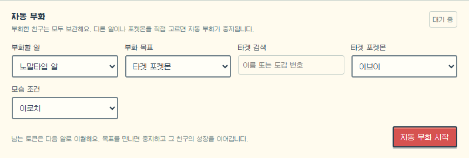
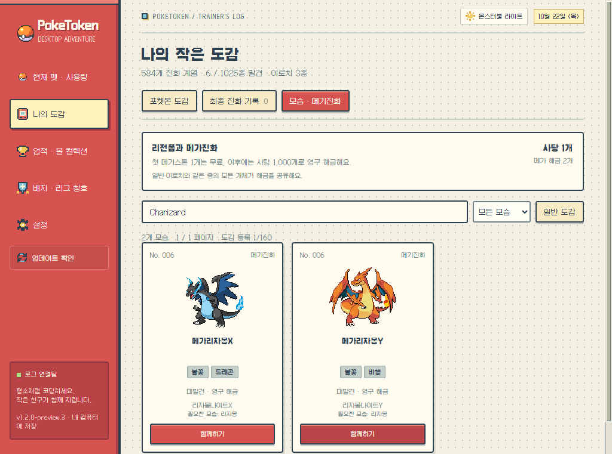
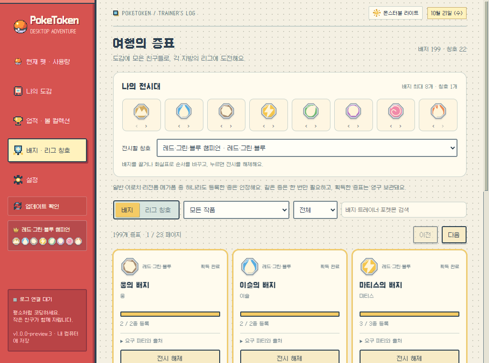

<p align="center">
  <a href="README.md"><kbd>English</kbd></a> &nbsp; <a href="README.ko.md"><kbd><strong>한국어</strong></kbd></a>
</p>

<p align="center"></p>

<h1 align="center">PokeToken Desktop</h1>

<p align="center">
  <strong>코딩하는 동안, 작은 친구의 모험이 자라요.</strong><br>
  Claude Code · Codex에서 사용한 토큰으로 포켓몬을 키우는 데스크톱 펫.<br>
  알을 부화하고, 도감을 채우고, 내 책상 위에 친구를 한 마리.
</p>

<p align="center">
   &nbsp;
   &nbsp;
   &nbsp;
  
</p>

<p align="center">
  <a href="https://github.com/KHLEE72/pokeTokenDesktop/releases/tag/v1.2.1"></a>
  
  
  <a href="LICENSE"></a>
</p>

<p align="center">
  <a href="#다운로드">다운로드</a> · <a href="#시작하기">시작하기</a> · <a href="#부화하고-키우고-모으고">성장과 도감</a> · <a href="#자동-부화로-원하는-친구-만나기">자동 부화</a> · <a href="#여행의-증표를-모아요">배지와 칭호</a>
</p>

<p align="center">
  
  <br><sub>English · 한국어 · 日本語 &nbsp; / &nbsp; 화면은 Windows에서 예시 데이터로 촬영했습니다.</sub>
</p>

<table>
  <tr>
    <td align="center" width="25%"><strong>포켓몬 1,025종</strong><br><sub>1세대부터 9세대까지</sub></td>
    <td align="center" width="25%"><strong>18가지 타입 알</strong><br><sub>타입을 고르고, 만남은 두근두근</sub></td>
    <td align="center" width="25%"><strong>리전폼 · 메가진화</strong><br><sub>같은 친구의 또 다른 모습</sub></td>
    <td align="center" width="25%"><strong>배지 199개 · 칭호 22개</strong><br><sub>내가 꾸미는 트레이너 전시대</sub></td>
  </tr>
</table>

## 다운로드

**내 컴퓨터에 맞는 파일을 고르세요.** Windows는 설치 없이 EXE 하나로 실행하고, Mac은 DMG를 열어 앱을 응용 프로그램 폴더로 옮깁니다.

| 운영체제 | v1.2.1 다운로드 |
| --- | --- |
| **Windows 10 / 11 · x64** | [포터블 EXE 받기](https://github.com/KHLEE72/pokeTokenDesktop/releases/download/v1.2.1/PokeToken-Desktop-1.2.1-win-x64.exe) |
| **macOS 14 이상 · Apple Silicon** | [DMG 받기 · M 시리즈](https://github.com/KHLEE72/pokeTokenDesktop/releases/download/v1.2.1/PokeToken-Desktop-1.2.1-mac-arm64.dmg) |
| **macOS 14 이상 · Intel** | [DMG 받기 · Intel](https://github.com/KHLEE72/pokeTokenDesktop/releases/download/v1.2.1/PokeToken-Desktop-1.2.1-mac-x64.dmg) |

<details>
<summary><strong>첫 실행 · 새 버전으로 바꾸기</strong></summary>

- 배포용 코드 서명·Apple 공증이 없는 빌드입니다. Mac에서 첫 실행을 막으면 [Mac 실행 안내](docs/MAC_TESTING.md)와 [Apple 안내](https://support.apple.com/ko-kr/102445)를 참고하세요.
- 사이드바의 **설정 아래 → 업데이트 확인**을 누르면 새 버전을 확인할 수 있습니다. Windows 포터블은 버튼을 눌러 새 EXE를 내려받고 검증한 뒤 교체·재실행합니다. Mac은 다운로드한 DMG로 직접 교체합니다.
- 업데이트 확인은 공개된 GitHub Releases를 사용합니다. 저장소가 비공개인 동안에는 앱에서 확인할 수 없으며, 앱에 GitHub 인증 토큰을 넣지 않습니다.
- 직접 교체할 때는 이전 앱을 트레이·메뉴바에서 먼저 종료하세요. 기존 Windows 설치형 사용자도 포터블로 전환할 수 있고, 같은 앱 데이터 폴더의 성장 기록을 이어갑니다.
- v1.2.0까지의 빌드는 이전 저장소 이름으로 업데이트 주소를 검사합니다. 이름이 바뀐 저장소의 업데이트를 이어가려면 v1.2.1을 한 번 직접 내려받아 실행하세요.

</details>

## 시작하기

1. **PokeToken Desktop을 실행하세요.** 화면 아래에 첫 알이 나타납니다.
2. **평소처럼 Claude Code나 Codex를 사용하세요.** 로컬 사용량 기록을 자동으로 찾습니다. 다른 경로나 WSL을 쓴다면 설정에서 폴더를 추가하세요.
3. **코딩하다 보면 알이 부화하고 포켓몬이 자라요.** 다른 타입이 궁금하면 **알 보관함**을 열어 골라보세요.

첫 실행 언어는 **영어**입니다. **Settings → Display language**에서 한국어·영어·일본어를 선택하면 재실행 후에도 기억합니다. 포켓몬·타입·아이템은 각 언어의 공식 명칭을 사용합니다.

> 기존 로그는 사용량 합계에 표시하고, 성장은 **연결 이후 새로 쓴 토큰부터** 반영합니다. 앱을 꺼둔 동안 사용한 토큰도 다음 실행에 반영해요. 기본 속도인 ‘빠름’에서 첫 알은 **50만 토큰**으로 부화합니다.

## 책상 위에서 함께 지내요

친구는 작업하는 동안 걷고, 쉬고, 말을 걸어요. 마우스로 집어 옮겨 바닥이나 창 위에 내려놓을 수도 있고, 잠시 몬스터볼에 넣어둘 수도 있습니다.

<table>
  <tr>
    <td align="center" width="25%"><br><strong>인사하기</strong><br><sub>클릭하면 하트와 대사로 반응해요.</sub></td>
    <td align="center" width="25%"><br><strong>집어 들기</strong><br><sub>드래그해서 원하는 곳으로 옮겨요.</sub></td>
    <td align="center" width="25%"><br><strong>내려놓기</strong><br><sub>공중에서 놓으면 떨어져 착지해요.</sub></td>
    <td align="center" width="25%"><br><strong>잠깐 쉬기</strong><br><sub>볼을 클릭하면 다시 나와요.</sub></td>
  </tr>
</table>

- **우클릭·트레이·메뉴바**에서 관리 화면 열기, 숨기기, 이동 일시정지, 볼에 넣기, 종료를 할 수 있어요. 관리 화면을 닫아도 펫은 계속 함께합니다.
- 모니터와 **96 / 128 / 192px** 크기를 고르세요. 투명한 부분은 클릭을 통과시키고, 펫이 움직여도 작업 중인 앱의 키보드 포커스를 유지합니다. 창 위에 올라서려면 창 윗부분에 펫이 설 공간이 필요해요.
- 포켓몬마다 도감의 생태와 성격을 참고해 새로 쓴 대사를 사용합니다. 쓰다듬기·잡기·낙하·착지도 몸의 특징에 맞춰 반응하며, 세 언어 모두 로컬에서 동작해요.
- 루차불·찌리비 등을 포함한 **움직이는 2D 도트**를 사용합니다. 동봉하거나 내려받은 그림은 보관해 오프라인에서도 재사용하며, 움직이는 모습이 없는 경우에는 정적 도트를 유지합니다.

## 부화하고, 키우고, 모으고

<table>
  <tr>
    <td width="50%" valign="top"><strong>🥚 어떤 알을 키울까요?</strong><br><br><br><sub>알을 바꿔도 각각의 부화 진행률을 보관해요.</sub></td>
    <td width="50%" valign="top"><strong>📕 내 작은 도감</strong><br><br><br><sub>만난 친구를 골라 함께하고, 이로치와 새로운 진화도 모아요.</sub></td>
  </tr>
</table>

| 지금 함께하는 친구 | 새로 쓴 토큰의 행선지 |
| --- | --- |
| 알 | 부화 경험치 |
| 진화가 남은 포켓몬 | 자동 성장 · 경험치사탕도 사용 가능 |
| 최종 진화한 친구, 이미 지나온 진화 단계의 모습, 메가진화 모습 | 경험치사탕 |
| 100%에서 분기 진화 목표를 기다리는 친구 | 목표를 고를 때까지 경험치사탕 |

**성장 상태는 개체마다 따로 보관합니다.** 도감에 등록한 포켓몬을 고르면 그 모습으로 함께해요. 진화가 남은 개체는 현재 성장 단계로 선택하면 다시 토큰으로 자라고, 이미 완성한 개체는 이전 모습으로 골라도 완성 상태를 유지합니다. 새로 키울 친구는 새 알에서 만날 수 있어요.

**경험치사탕:** 사탕으로 적립되는 토큰 **10만 개당 사탕 1개**, 사탕 1개는 **10만 XP**입니다. 성장 중인 포켓몬에게 먹일 수 있고, 알에는 먹일 수 없어요. 펫을 숨기거나 볼에 넣어도 성장은 이어집니다.

<details>
<summary><strong>분기 진화 · 이로치 확률 · 도감 도구 자세히</strong></summary>

- **1~9세대 기본 모습 1,025종**을 지원하고 일반·이로치 도감을 따로 기록합니다. 이로치 확률은 **부화마다 1/64**, 진화해도 이로치를 유지해요.
- **진화 방향을 직접 고릅니다.** 이브이의 8가지 진화, 킬리아·카르본 같은 분기 계열도 목표를 선택할 수 있어요. 통신·돌 등 원작의 진화 조건은 토큰 성장으로 단순화했습니다.
- **알 타입은 실제 부화하는 첫 모습 기준입니다.** 님피아는 페어리타입 알에서 바로 나오지 않고, 노말타입 알에서 만난 이브이를 진화시켜 얻어요. 도감을 완성한 뒤에도 중복 부화할 수 있습니다.
- 같은 타입 알 안에서 계열별 상대 가중치는 일반 **100**, 전설 **10**, 환상 **3**입니다. 도감의 준전설·전설·환상 표시 분류가 확률을 추가로 바꾸지는 않아요.
- **번호순·공식 이름순·획득순**으로 정렬하고, 획득순은 최근 등록한 친구부터 보여줍니다. 이름·번호 검색과 세대·타입·희귀도·발견 상태 필터를 제공하며, 최종 진화 기록은 별도 탭에서 페이지로 나눠 봅니다.
- **빠름·기본·느림** 속도를 고를 수 있습니다. 속도를 바꾸면 현재 단계의 진행률을 유지하고, 다음 단계로 넘어간 초과 경험치는 이월해요. 다른 알이나 친구로 바꿔도 기존 진행률을 보관합니다.

</details>

## 자동 부화로 원하는 친구 만나기

**알 보관함 → 자동 부화**에서 설정하세요. 코딩으로 모은 토큰으로 알을 계속 부화시키거나, 원하는 친구를 만났을 때 멈출 수 있어요.

<p align="center"></p>

| 모드 | 알이 부화한 다음에는? |
| --- | --- |
| **랜덤 알** | 다음 알의 타입을 무작위로 고릅니다. |
| **타입 알 + 랜덤 포켓몬** | 같은 타입의 알을 계속 키웁니다. |
| **타입 알 + 타겟 포켓몬** | **일반·이로치·상관없음** 중 고른 조건의 타겟이 나올 때까지 반복합니다. |

부화한 친구는 **모두 보관**하고 도감·이로치도 기존처럼 등록합니다. 타겟은 해당 알에서 실제 부화할 수 있는 모습만 고를 수 있어요. 남는 경험치는 다음 알로 이월하며, 요구 경험치와 부화 확률은 그대로입니다.

목표를 만나면 자동 부화가 꺼지고, 남은 경험치로 그 친구의 일반 성장을 이어갑니다. 다른 알이나 포켓몬을 직접 골라도 자동 부화가 중지돼요. 진행 중인 알과 먼저 만난 친구들은 재실행 후에도 그대로 남습니다.

## 리전폼과 메가진화

<p align="center"></p>

**도감 → 모습 · 메가진화**에서 **리전폼 57종·특별한 모습 6종·메가폼 97종**을 모으세요. 가라르 지그제구리 → 가로막구리, 팔데아 우파 → 토오처럼 리전폼마다 맞는 진화 경로를 따릅니다.

- **첫 메가스톤 해금 1개는 무료**, 이후에는 **경험치사탕 1,000개**로 영구 해금합니다. 일반·이로치와 같은 종의 모든 개체가 해금을 공유해요.
- 필요한 기본 모습을 만난 뒤 스톤을 해금하고, 홈 화면이나 모습 도감에서 메가폼을 고르면 됩니다. 리자몽 X·Y는 별도 해금이고, 레쿠쟈는 같은 가격의 화룡점정 해금을 사용해요.
- 원래 모습으로 돌아와도 성장 상태와 볼을 유지합니다. **메가진화는 표시하는 모습**이며, 새 토큰은 사탕으로 모여요. 기본 도감과 모습 도감은 따로 기록합니다.

## 여행의 증표를 모아요

관장의 파티에 포함된 포켓몬을 모으면 배지를, 해당 작품의 사천왕·챔피언 파티까지 모으면 리그 칭호를 얻습니다. **22개 작품의 배지 199개·칭호 22개**, 알로라의 시련·큰 시련도 함께해요.

<p align="center"></p>

- 파티는 재대결·후반 전투를 우선하고, 없으면 첫 전투를 기준으로 합니다. 각 카드에서 채택한 전투와 필요 포켓몬·출처를 확인할 수 있어요.
- 기존 도감도 즉시 인정하고 **일반·이로치·폼을 같은 종으로 합산**합니다. 같은 종이 여러 번 나와도 한 번만 등록하면 되고, 얻은 배지·칭호는 영구 보관해요.
- 여러 지방에서 고른 **배지 최대 8개·칭호 1개**를 전시합니다. 드래그나 화살표로 순서를 바꾸고, 전시만 해제할 수도 있어요.
- 전시대는 **홈 인사말 오른쪽과 사이드바 업데이트 버튼 아래**에 나타납니다. 배지는 작품별 실제 디자인을 반영하며, 알로라는 Z크리스털·섬 시련 도장을 사용해요.

## 내 취향으로 꾸미기

<table>
  <tr>
    <td width="50%" align="center"><br><strong>몬스터볼 라이트</strong></td>
    <td width="50%" align="center"><br><strong>보라시티 다크</strong></td>
  </tr>
</table>

업적을 달성하면 볼과 그에 어울리는 테마가 열립니다. 친구마다 고르는 볼과 앱 전체 테마는 따로 설정해요. 라이트와 보라시티 다크는 처음부터 사용할 수 있습니다.

<p align="center">
   &nbsp;
   &nbsp;
   &nbsp;
   &nbsp;
   &nbsp;
   &nbsp;
   &nbsp;
   &nbsp;
   &nbsp;
  
</p>

<details>
<summary><strong>볼 전체 획득 조건</strong></summary>

| 볼 | 획득 조건 |
| --- | --- |
| 몬스터볼 | 처음부터 함께 |
| 슈퍼볼 | 연결 후 새 토큰 100만 |
| 하이퍼볼 | 연결 후 새 토큰 5,000만 |
| 프리미어볼 | 첫 최종 진화 |
| 럭셔리볼 | 이로치 한 종류 발견 |
| 다크볼 | 고스트 타입 3종 등록 |
| 마스터볼 | 1,025종을 일반 또는 이로치 도감에 등록 |
| 타이머볼 | 준전설 3종 등록 |
| 드림볼 | 전설 1종 등록 |
| 프레셔스볼 | 환상 1종 등록 |

수집 업적은 기존 도감도 인정하고, 이전 버전에서 얻은 볼을 포함해 이미 얻은 보상은 유지합니다. 설정에서는 펫 크기·모니터·이동 일시정지와 컴퓨터를 켤 때 자동 시작도 고를 수 있어요. 자동 시작은 기본으로 꺼져 있습니다.


</details>

## 내 컴퓨터에 남는 기록

관리 화면에서 **오늘·전체 로컬 사용량, 도구별 합계, 성장률, 사탕, 연결 상태**를 확인합니다. 입력·출력·캐시 읽기·캐시 쓰기 토큰을 중복 없이 합산해 성장에 사용해요.

| 사용 도구 | 연결 방법 |
| --- | --- |
| **Claude Code** | `~/.claude/projects` · `CLAUDE_CONFIG_DIR` 반영 |
| **Codex** | `~/.codex/sessions` · `~/.codex/archived_sessions` · `CODEX_HOME` 반영 |
| **WSL · 사용자 지정 폴더** | 설정에서 도구별로 Windows가 읽을 수 있는 로그 폴더를 추가합니다. 예: `\\wsl.localhost\Ubuntu\home\yourname\.claude\projects` |
| **Claude Desktop 일반 채팅·웹 채팅·휴대폰에서만 사용한 기록** | 지원하는 로컬 코딩 로그가 없어 수집하지 않습니다. |

사용량과 성장 상태는 내 컴퓨터에 저장합니다. **대화 본문·인증 정보는 저장하거나 전송하지 않고**, 펫 대사에 별도 AI 호출을 사용하지 않아요. 이미지 다운로드와 GitHub 업데이트 확인에는 네트워크를 사용하며, 동봉·캐시된 그림은 오프라인에서도 재사용합니다.

<details>
<summary><strong>내 도감 백업하기</strong></summary>

앱을 종료한 뒤 아래 폴더 전체를 복사하세요.

| Windows | macOS |
| --- | --- |
| `%APPDATA%\PokeToken Desktop` | `~/Library/Application Support/PokeToken Desktop` |

Windows EXE는 포터블이지만 저장 데이터는 실행 파일과 별도로 이 폴더에 보관합니다.

</details>

<details>
<summary><strong>직접 실행하고 기여하기</strong></summary>

Electron · React · TypeScript · SQLite로 만들었습니다. **Node.js 22.12 이상**과 npm을 사용합니다.

```sh
git clone https://github.com/KHLEE72/pokeTokenDesktop.git
cd pokeTokenDesktop
npm ci
npm run dev
```

빌드·검증은 [개발 안내](docs/DEVELOPMENT.md), 코드 변경을 보내기 전에는 [기여 안내](CONTRIBUTING.md)를 참고하세요.

</details>

---

<p align="center">
  <br>
  <strong>오늘 쌓은 코드만큼, 함께한 시간도 차곡차곡.</strong><br><br>
  <sub><a href="https://github.com/chattymin/PokeTokenBar">PokeTokenBar</a>에서 아이디어를 얻었습니다.<br>
  앱 코드: <a href="LICENSE">MIT</a> · 이미지·명칭·글꼴과 크레딧: <a href="THIRD_PARTY_NOTICES.md">서드파티 고지</a><br>
  비공식 팬 프로젝트이며 Pokémon 이미지와 명칭의 권리는 각 권리자에게 있습니다.</sub>
</p>
