<p align="center">
  <a href="README.md"><kbd><strong>English</strong></kbd></a> &nbsp; <a href="README.ko.md"><kbd>한국어</kbd></a>
</p>

<p align="center"></p>

<h1 align="center">PokeToken Desktop</h1>

<p align="center">
  <strong>Your code. Their next adventure.</strong><br>
  Turn your Claude Code &amp; Codex tokens into a little Pokémon companion.<br>
  Hatch eggs, grow your collection, and keep a friend on your desktop.
</p>

<p align="center">
  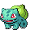 &nbsp;
   &nbsp;
  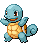 &nbsp;
  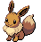
</p>

<p align="center">
  <a href="https://github.com/KHLEE72/pokeTokenShimeji/releases/tag/v1.2.0"></a>
  
  
  <a href="LICENSE"></a>
</p>

<p align="center">
  <a href="#download">Download</a> · <a href="#get-started">Get started</a> · <a href="#hatch-grow-collect">Collection</a> · <a href="#auto-hatch-find-your-next-friend">Auto hatch</a> · <a href="#badges-with-a-story">Badges</a>
</p>

<p align="center">
  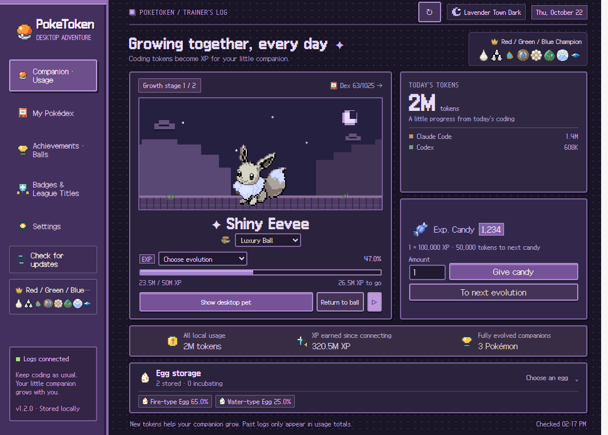
  <br><sub>English · 한국어 · 日本語 &nbsp; / &nbsp; Screenshots use example data on Windows.</sub>
</p>

<table>
  <tr>
    <td align="center" width="25%"><strong>1,025 Pokémon</strong><br><sub>Generations I–IX</sub></td>
    <td align="center" width="25%"><strong>18 egg types</strong><br><sub>Pick a type. Meet a surprise.</sub></td>
    <td align="center" width="25%"><strong>Regional &amp; Mega forms</strong><br><sub>A collection beyond the basics</sub></td>
    <td align="center" width="25%"><strong>199 badges · 22 titles</strong><br><sub>Your own trainer showcase</sub></td>
  </tr>
</table>

## Download

**Choose your platform.** Windows runs from a single portable EXE; on Mac, open the DMG and drag the app into Applications.

| Platform | Download v1.2.0 |
| --- | --- |
| **Windows 10 / 11 · x64** | [Download portable EXE](https://github.com/KHLEE72/pokeTokenShimeji/releases/download/v1.2.0/PokeToken-Desktop-1.2.0-win-x64.exe) |
| **macOS 14+ · Apple Silicon** | [Download DMG · M-series](https://github.com/KHLEE72/pokeTokenShimeji/releases/download/v1.2.0/PokeToken-Desktop-1.2.0-mac-arm64.dmg) |
| **macOS 14+ · Intel** | [Download DMG · Intel](https://github.com/KHLEE72/pokeTokenShimeji/releases/download/v1.2.0/PokeToken-Desktop-1.2.0-mac-x64.dmg) |

<details>
<summary><strong>First launch &amp; keeping the app up to date</strong></summary>

- These builds do not have commercial code signing or Apple notarization. If macOS blocks the first launch, see the [Mac launch guide](docs/MAC_TESTING.md) and [Apple's instructions](https://support.apple.com/en-us/102445).
- **Check for updates** is below Settings in the sidebar. On Windows portable builds, the update button downloads and verifies the new EXE, replaces the old one, and restarts the app. Mac builds open the download for manual replacement.
- Update checks use public GitHub Releases. A private repository cannot be checked by the app; no GitHub token is bundled.
- To replace a version manually, quit the previous app from the tray or menu bar first. Older Windows installer users can switch to the portable EXE. Saved progress stays in the same application data folder.

</details>

## Get started

1. **Launch PokeToken Desktop.** Your first egg appears at the bottom of the screen.
2. **Use Claude Code or Codex as usual.** Local usage logs are detected automatically. Add custom or WSL folders in Settings if needed.
3. **Keep coding, then meet your companion.** New tokens hatch and evolve Pokémon. Open **Egg storage** whenever you want to choose another type.

The first launch is in **English**. Choose English, 한국어, or 日本語 in **Settings → Display language**; your choice is remembered. Pokémon, types, and items use their official localized names.

> Existing logs appear in your usage totals. Growth starts with **new tokens after connection**, including tokens used while PokeToken is closed. Your first egg needs **500,000 tokens** at the default Fast pace.

## A little life on your desktop

Your companion walks, rests, and chats while you work. Pick it up, drop it onto the desktop or a window's top edge, or tuck it into a Poké Ball for a quieter desk.

<table>
  <tr>
    <td align="center" width="25%">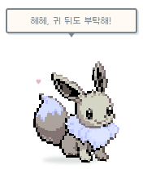<br><strong>Say hello</strong><br><sub>Click for hearts and a line of dialogue.</sub></td>
    <td align="center" width="25%">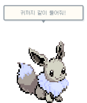<br><strong>Pick up</strong><br><sub>Drag your friend to a new spot.</sub></td>
    <td align="center" width="25%">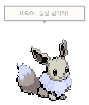<br><strong>Let go</strong><br><sub>Watch it fall and land.</sub></td>
    <td align="center" width="25%"><br><strong>Take a break</strong><br><sub>Click the ball to bring your friend back.</sub></td>
  </tr>
</table>

- **Right-click or use the tray/menu bar** to open the dashboard, hide the pet, pause movement, return to its ball, or quit. Closing the dashboard keeps your companion running.
- Choose a monitor and a **96 / 128 / 192 px** pet size. Transparent areas let clicks through, and movement preserves the keyboard focus of your work app. A window needs room above its top edge for the pet to stand there.
- Each Pokémon has original dialogue inspired by its Pokédex traits, with reactions for petting, being held, falling, and landing. Lines are selected locally in all three languages.
- Animated **2D pixel sprites** include extra animations for Pokémon such as Hawlucha and Wattrel. Sprites are bundled or cached for reuse offline; a static sprite remains available when an animated variant is unavailable.

## Hatch, grow, collect

<table>
  <tr>
    <td width="50%" valign="top"><strong>🥚 Choose an egg</strong><br><br>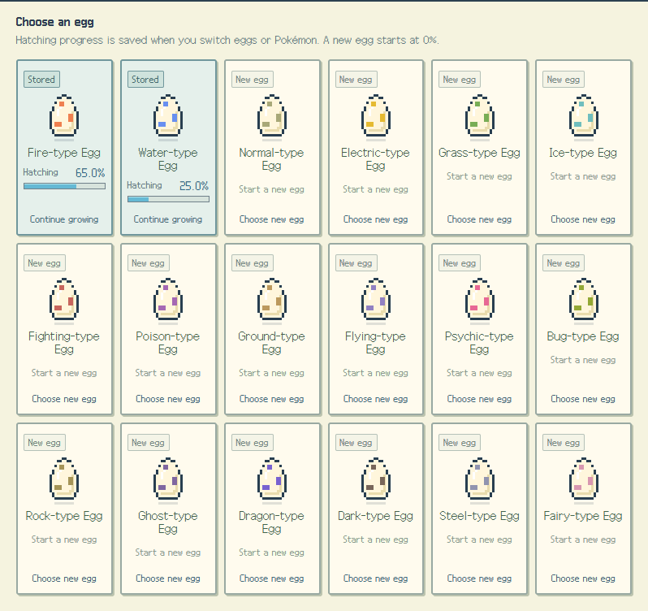<br><sub>Switch eggs whenever you like. Each egg keeps its progress.</sub></td>
    <td width="50%" valign="top"><strong>📕 Build your Pokédex</strong><br><br>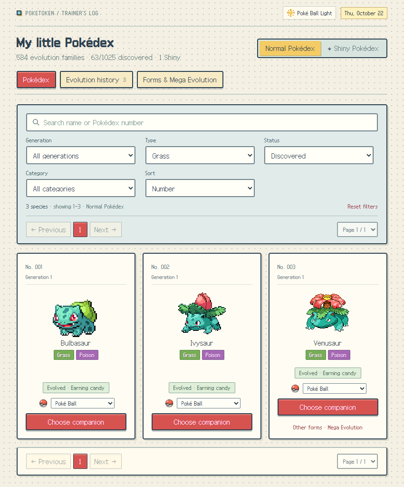<br><sub>Choose a registered companion, find a Shiny, or follow a new evolution branch.</sub></td>
  </tr>
</table>

| Your active companion | Where new tokens go |
| --- | --- |
| An egg | Hatching progress |
| A Pokémon with an evolution ahead | Automatic growth; Exp. Candy can help too |
| A fully evolved Pokémon, an earlier form of an already-evolved companion, or a Mega form | Exp. Candy |
| A branching evolution waiting for your choice at 100% | Exp. Candy until you choose a target |

**Every companion keeps its own progress.** Pick a registered Pokémon from the Pokédex to display it. Selecting a companion at its current growing stage resumes token growth; a completed one stays completed, even if you display an earlier form. New eggs create new companions.

**Exp. Candy:** every **100,000 tokens** sent to candy makes one candy, worth **100,000 XP**. Feed it to a growing Pokémon whenever you like. Eggs cannot eat candy. Growth continues while your pet is hidden or inside a ball.

<details>
<summary><strong>Evolution routes, Shiny odds &amp; Pokédex tools</strong></summary>

- **1,025 species, generations I–IX.** Normal and Shiny collections are tracked separately. Shiny odds are **1/64 per hatch**, and the variant stays with the companion through evolution.
- **Choose your evolution branch.** Eevee has eight destinations; other branching lines such as Kirlia and Charcadet also offer a target choice. Trade, stone, and other evolution requirements are simplified into token growth.
- **Egg types follow the hatchable first form.** Sylveon comes from evolving an Eevee hatched from a Normal-type Egg; it is not a Fairy-type Egg hatch. A full Pokédex does not prevent duplicate hatches.
- Hatch selection uses relative family weights: ordinary **100**, legendary **10**, mythical **3** within the chosen type. The Sub-Legendary / Legendary / Mythical labels in the Pokédex are display categories and do not add another probability modifier.
- Sort by **Pokédex number, localized name, or acquisition** (newest first). Search by official name or number; filter by generation, type, rarity, and discovery status. Final evolution records have their own paginated tab.
- Choose **Fast / Normal / Slow** growth. Changing pace preserves the current stage's percentage; overflow carries into the next stage. Choosing a different companion or egg preserves the stored progress.

</details>

## Auto hatch: find your next friend

**Open Egg storage → Auto hatch.** Keep hatching while your coding tokens arrive, or stop when you meet a particular Pokémon.

<p align="center">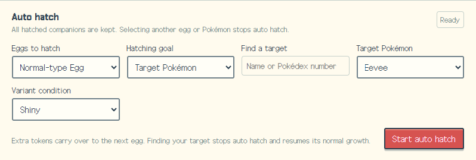</p>

| Mode | What happens after a hatch |
| --- | --- |
| **Random egg** | A random egg type is selected for the next hatch. |
| **One egg type + random Pokémon** | Another egg of that same type starts. |
| **One egg type + target Pokémon** | Hatching repeats until the target appears as **Normal, Shiny, or either**, as selected. |

All hatched companions are kept, with normal Pokédex and Shiny registration. Only forms that can actually hatch from that egg are offered as targets. Extra XP carries into the next egg, with the usual cost and odds.

Once the target appears, auto hatch stops and that companion resumes ordinary growth using the remaining XP. Manually selecting an egg or another companion also stops auto hatch. The current egg's progress and all earlier companions remain saved across restarts.

## Regional forms &amp; Mega Evolution

<p align="center">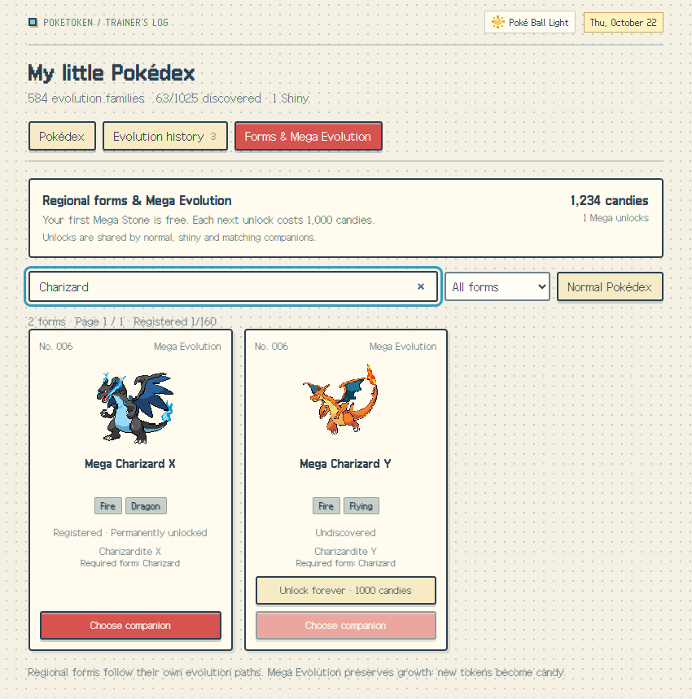</p>

Collect **57 regional forms**, **6 special forms**, and **97 Mega forms** in **Pokédex → Forms · Mega Evolution**. Regional forms follow their own evolution routes, including Galarian Zigzagoon → Obstagoon and Paldean Wooper → Clodsire.

- **Your first Mega Stone unlock is free.** Each later unlock costs **1,000 Exp. Candies** and is permanent, shared across all companions and both Normal/Shiny variants.
- Meet the required base form, unlock its stone, then select a Mega form from the home screen or the forms collection. Charizard's X and Y forms use separate unlocks; Rayquaza uses a Dragon Ascent unlock with the same pricing.
- Switching back preserves the companion's growth and ball. **Mega Evolution is a display form**, with new tokens collected as candy. Basic and form Pokédex records stay separate.

## Badges with a story

Collect the Pokémon from a Gym Leader's team to earn their badge. Complete a game's Elite Four and Champion teams to earn its league title. There are **199 badges and 22 titles across 22 game entries**, including Alola's trials and grand trials.

<p align="center">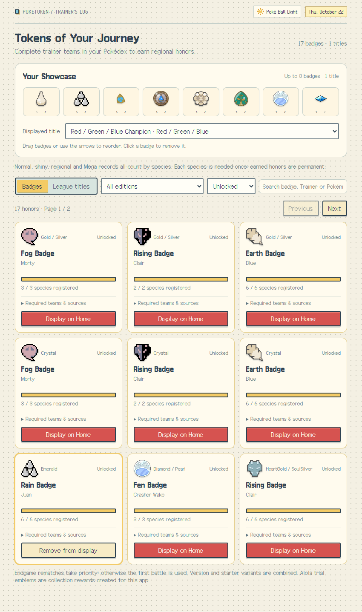</p>

- Teams use a rematch or later battle where available, with the original battle as a fallback. Each requirement card shows the chosen battle, Pokémon, and source.
- Existing discoveries count immediately. **Normal, Shiny, and forms count as the same species** for these goals, and one registration is enough for repeated party members. Earned badges and titles stay unlocked.
- Showcase **up to eight badges from any regions and one title**. Drag or use arrows to reorder them; remove a display without losing the reward.
- Your showcase appears **beside the home greeting and below the sidebar's update button**. Badge art follows the individual game's design, including Alola's Z-Crystals and trial stamps.

## Make the desk yours

<table>
  <tr>
    <td width="50%" align="center">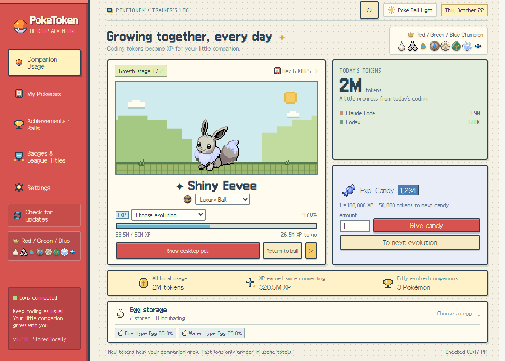<br><strong>Poké Ball Light</strong></td>
    <td width="50%" align="center"><br><strong>Lavender Town Dark</strong></td>
  </tr>
</table>

Unlock balls and matching themes through achievements. The ball belongs to each companion; the app theme is chosen separately. Light and Lavender Town Dark are available from the start.

<p align="center">
   &nbsp;
   &nbsp;
   &nbsp;
   &nbsp;
   &nbsp;
   &nbsp;
   &nbsp;
   &nbsp;
   &nbsp;
  
</p>

<details>
<summary><strong>All ball rewards</strong></summary>

| Ball | Unlock condition |
| --- | --- |
| Poké Ball | Available from the start |
| Great Ball | 1 million new tokens after connection |
| Ultra Ball | 50 million new tokens after connection |
| Premier Ball | First fully evolved companion |
| Luxury Ball | Discover a Shiny Pokémon |
| Dusk Ball | Register 3 Ghost-type species |
| Master Ball | Register all 1,025 species in either the Normal or Shiny Pokédex |
| Timer Ball | Register 3 Sub-Legendary species |
| Dream Ball | Register 1 Legendary species |
| Cherish Ball | Register 1 Mythical species |

Previously registered Pokémon count toward collection rewards. Earned rewards are kept, including unlocks from earlier versions. Settings also include pet size, monitor, movement pause, and optional launch at login, which is off by default.

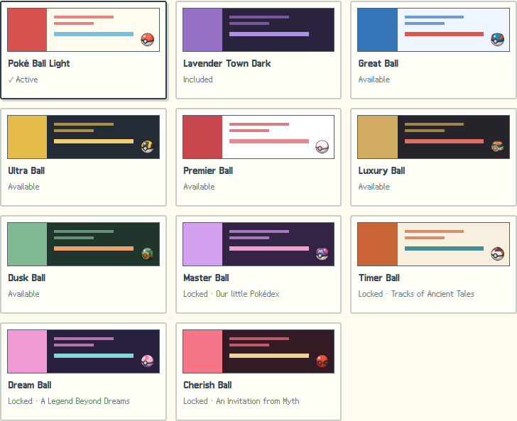

</details>

## Local logs, local progress

The dashboard shows **today's and all-time local usage, per-tool totals, growth, candy, and connection status**. Input, output, cache-read, and cache-write tokens count toward growth without counting the same usage twice.

| Source | How it connects |
| --- | --- |
| **Claude Code** | `~/.claude/projects` · respects `CLAUDE_CONFIG_DIR` |
| **Codex** | `~/.codex/sessions` and `~/.codex/archived_sessions` · respects `CODEX_HOME` |
| **WSL / custom folders** | Add a Windows-readable log folder for each tool in Settings. Example: `\\wsl.localhost\Ubuntu\home\yourname\.claude\projects` |
| **Ordinary Claude Desktop chats, web chats, or phone-only usage** | Not collected; these do not provide the supported local coding logs. |

PokeToken stores usage and game progress on your computer. **Conversation text and credentials are not stored or sent**, and dialogue needs no AI calls. Sprite downloads and GitHub update checks use the network; bundled and cached artwork can be reused offline.

<details>
<summary><strong>Back up your collection</strong></summary>

Quit the app, then copy the entire application data folder:

| Windows | macOS |
| --- | --- |
| `%APPDATA%\PokeToken Desktop` | `~/Library/Application Support/PokeToken Desktop` |

The Windows EXE is portable, but your saved data lives in this folder, separately from the executable.

</details>

<details>
<summary><strong>Run from source &amp; contribute</strong></summary>

Built with Electron, React, TypeScript, and SQLite. Use **Node.js 22.12+** and npm:

```sh
git clone https://github.com/KHLEE72/pokeTokenShimeji.git
cd pokeTokenShimeji
npm ci
npm run dev
```

See the [development guide](docs/DEVELOPMENT.md) for builds and checks, and the [contributing guide](CONTRIBUTING.md) before sending a change. Supporting technical documents are currently in Korean.

</details>

---

<p align="center">
  <br>
  <strong>A little progress. A little company.</strong><br><br>
  <sub>Inspired by <a href="https://github.com/chattymin/PokeTokenBar">PokeTokenBar</a>.<br>
  App code: <a href="LICENSE">MIT</a> · Artwork, names, fonts &amp; credits: <a href="THIRD_PARTY_NOTICES.md">Third-party notices</a><br>
  An unofficial fan project. Pokémon artwork and names belong to their respective rights holders.</sub>
</p>
