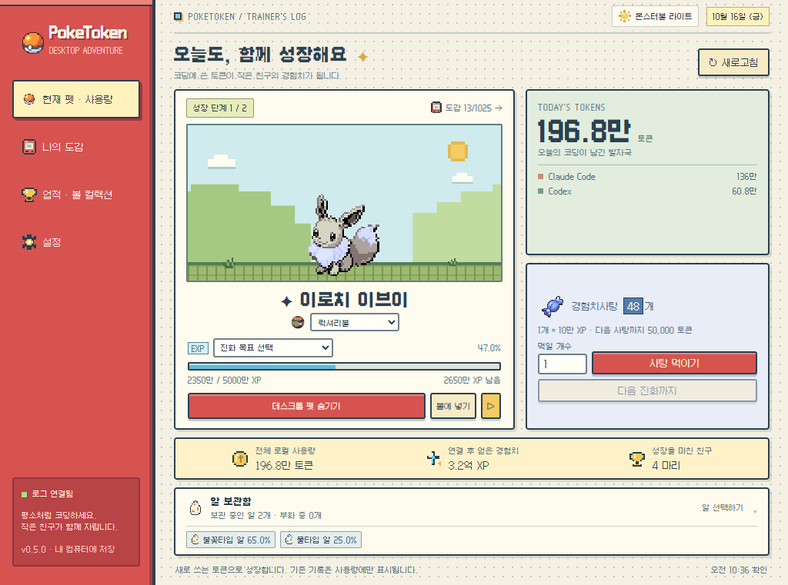
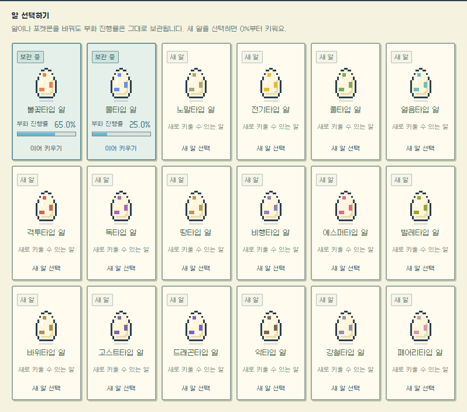
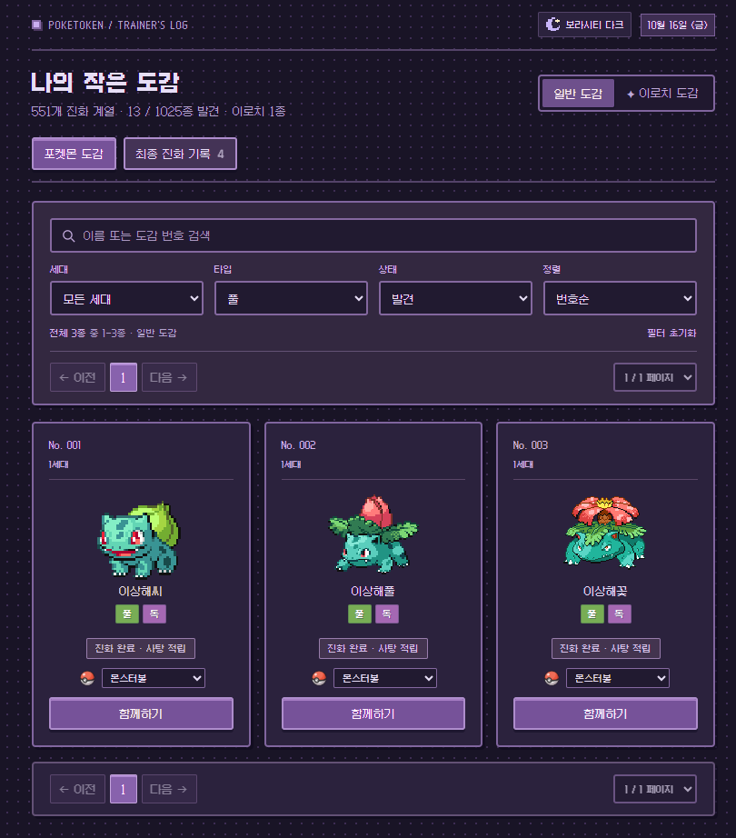
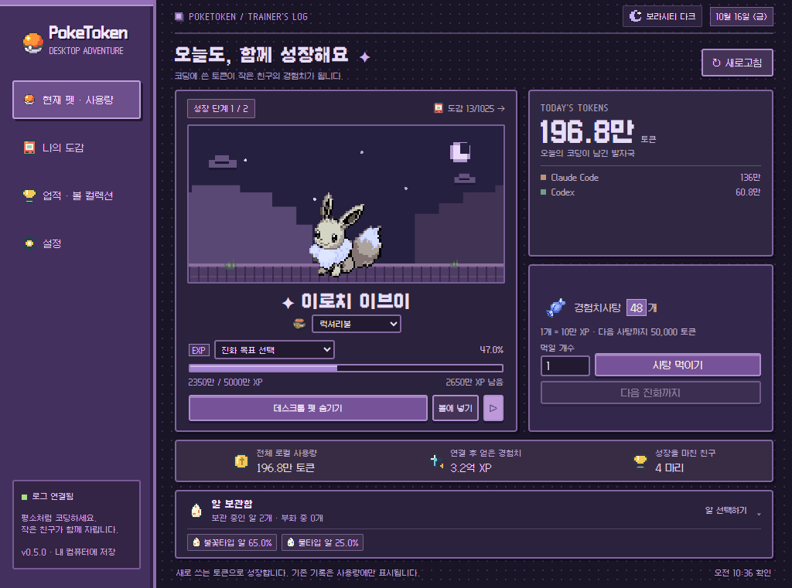
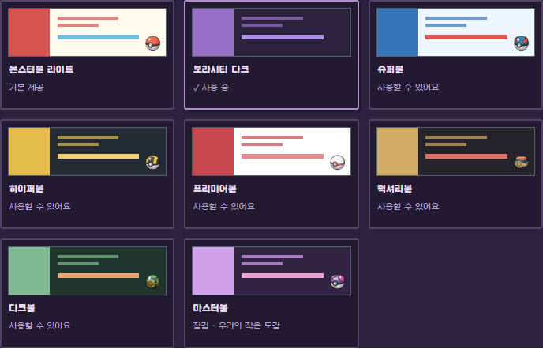

<p align="center">
  
</p>

<h1 align="center">PokeToken Desktop</h1>

<p align="center">
  <strong>코딩하는 동안, 작은 친구가 함께 자랍니다.</strong><br>
  Claude Code·Codex에 쓴 토큰으로 알을 부화시키고, 포켓몬과 데스크톱을 함께 걸어보세요.
</p>

<p align="center">
  &nbsp;&nbsp;
  &nbsp;&nbsp;
  &nbsp;&nbsp;
  
</p>

<p align="center">
  <a href="#다운로드"><strong>다운로드</strong></a> &nbsp;·&nbsp;
  <a href="#처음-시작하기">처음 시작하기</a> &nbsp;·&nbsp;
  <a href="#성장과-수집">성장과 수집</a> &nbsp;·&nbsp;
  <a href="#내-취향대로">내 취향대로</a>
</p>

<p align="center">
  <kbd>Windows 10/11</kbd> &nbsp; <kbd>macOS 14+</kbd><br>
  <sub>한국어 · English · 日本語</sub>
</p>

<p align="center">
  
  <br><sub>화면은 개인 기록이 없는 예시 데이터로 촬영했습니다. 기능·화면 소개는 Windows 배포판 기준입니다.</sub>
</p>

## 작은 친구와 함께하는 코딩

<table>
  <tr>
    <td width="50%" valign="top"><strong>🐾 화면 위의 작은 친구</strong><br>바닥과 창 위를 걷고 쉬어요. 쓰다듬거나 들어 올리면 상황에 맞는 동작과 대사로 반응합니다.</td>
    <td width="50%" valign="top"><strong>🥚 코딩이 성장이 되는 순간</strong><br>평소처럼 도구를 사용하세요. 새로 쓴 토큰이 경험치가 되어 알이 부화하고 포켓몬이 진화합니다.</td>
  </tr>
  <tr>
    <td valign="top"><strong>📖 나의 작은 도감</strong><br>18개 타입의 알, 1~9세대 1,025종의 포켓몬. 만난 친구를 도감에서 골라 함께할 수 있어요.</td>
    <td valign="top"><strong>🍬 사탕과 반짝이는 만남</strong><br>성장을 마친 뒤에도 토큰은 경험치사탕으로 모여요. 알에서는 이로치가 태어나기도 합니다.</td>
  </tr>
  <tr>
    <td valign="top"><strong>✨ 내가 고르는 진화</strong><br>이브이의 진화 목표를 직접 고르세요. 개체마다 성장 상태와 실제로 거친 진화 경로를 보관합니다.</td>
    <td valign="top"><strong>🎨 볼과 테마로 꾸미기</strong><br>업적을 달성해 볼과 화면 테마를 모으세요. 포켓몬의 볼과 관리 화면의 테마를 각각 고를 수 있어요.</td>
  </tr>
</table>

## 다운로드

| 환경 | 다운로드 | 실행 방법 |
| --- | --- | --- |
| **Windows 10/11 · x64** | [Windows EXE](https://github.com/KHLEE72/pokeTokenShimeji/releases/download/v0.4.12/PokeToken-Desktop-0.4.12-win-x64.exe) | 설치 없이 파일 실행 |
| **Mac · Apple Silicon** | [M 시리즈 DMG](https://github.com/KHLEE72/pokeTokenShimeji/releases/download/v0.4.9/PokeToken-Desktop-0.4.9-mac-arm64.dmg) | 앱을 응용 프로그램 폴더로 이동 |
| **Mac · Intel** | [Intel DMG](https://github.com/KHLEE72/pokeTokenShimeji/releases/download/v0.4.9/PokeToken-Desktop-0.4.9-mac-x64.dmg) | 앱을 응용 프로그램 폴더로 이동 |

Windows는 **v0.4.12**, Mac은 **v0.4.9** 배포 파일입니다. Mac 첫 실행은 [설치 안내](docs/MAC_TESTING.md)를 참고하세요. 모든 배포 파일은 [Releases](https://github.com/KHLEE72/pokeTokenShimeji/releases)에서 확인할 수 있습니다.

기존 앱이 켜져 있다면 트레이·메뉴바에서 **종료**한 뒤 새 파일을 실행하세요. 성장·도감·사탕·설정은 이어집니다. 비공개 저장소의 파일을 받으려면 저장소 접근 권한이 필요합니다.

## 처음 시작하기

1. **앱을 실행하세요.** 관리 화면과 화면 아래의 알이 나타납니다. 관리 화면을 닫아도 펫은 계속 함께해요.
2. **평소처럼 Claude Code·Codex를 사용하세요.** 기본 로그 폴더를 자동으로 찾습니다. 처음 연결한 과거 기록은 사용량에 표시하고, 연결 후 새로 쓴 토큰부터 성장에 반영합니다.
3. **함께할 친구를 골라보세요.** 홈의 **알 보관함**에서 타입을 선택하거나, **나의 도감**에서 만난 포켓몬을 꺼내세요. 다른 친구를 고르는 동안에도 이전 진행률은 보관됩니다.

첫 실행은 **English**로 시작합니다. **Settings → Display language**에서 한국어·English·日本語를 고르면 다음 실행에도 기억합니다.

### 어떤 알을 키워볼까요?

<p align="center">
  
</p>

**알 보관함 → 알 선택하기**에서 원하는 타입을 고르세요. 보관 중인 알은 진행률부터 이어 키우고, 새 타입의 알은 0%부터 시작합니다. 어떤 친구가 태어날지는 부화할 때 확인하세요.

### 기록 폴더 직접 연결하기

**설정 → 토큰 사용 기록 연결 → 폴더 추가**에서 연결합니다. 수집 대상은 Claude Code·Codex의 **로컬 개발 로그**입니다.

| 도구 | 기본 폴더 | 추가할 폴더 |
| --- | --- | --- |
| Claude Code | `~/.claude/projects` | `projects` |
| Codex | `~/.codex/sessions` · `~/.codex/archived_sessions` | `sessions` · `archived_sessions` |

설정한 `CLAUDE_CONFIG_DIR`·`CODEX_HOME`이 있으면 해당 위치를 우선합니다. WSL은 `\\wsl.localhost\배포판\home\사용자\.claude\projects`처럼 Windows에서 읽을 수 있는 폴더를 선택하세요. 사용량은 주기적으로 확인하며 홈의 **새로고침**으로 바로 읽을 수도 있습니다.

## 친구와 놀아주기

<table>
  <tr>
    <th>쓰다듬기</th><th>살짝 들어 올리기</th><th>아래로 내려오기</th><th>볼 안에서 쉬기</th>
  </tr>
  <tr>
    <td align="center"></td>
    <td align="center"></td>
    <td align="center"></td>
    <td align="center"></td>
  </tr>
</table>

| 이렇게 해보세요 | 친구의 반응 |
| --- | --- |
| **짧게 클릭** | 쓰다듬기 동작, 하트와 상황별 대사 |
| **잡고 드래그** | 들어 올린 채로 따라오기 |
| **높은 곳에서 놓기** | 아래로 떨어져 바닥이나 창 위에 착지 |
| **볼에 넣기** | 작은 볼로 머무르기 · 볼을 클릭하면 다시 나오기 |
| **우클릭 / 트레이·메뉴바** | 관리 화면 열기, 보이기·숨기기, 이동 일시정지, 설정·종료 |

창 위에 올리고 싶다면 창을 화면 맨 위에서 조금 내려놓고, 위쪽 테두리 가까이에 펫을 놓아보세요. 볼 안에서도 토큰으로 계속 성장합니다.

## 성장과 수집

<p align="center">
  
</p>

**알 → 부화 → 진화 → 최종 진화.** 기본 선택인 ‘빠름’에서는 **50만 토큰**으로 부화합니다. 진화에 필요한 경험치는 홈의 성장 바에서 확인하세요.

| 지금 함께하는 모습 | 새 토큰은 어디로 갈까요? |
| --- | --- |
| 알 | 부화 경험치 |
| 성장 중인 현재 형태 | 다음 진화를 위한 경험치 |
| 최종 진화·이미 완성한 이전 모습 | 경험치사탕 |
| 진화 목표 선택을 기다리는 상태 | 경험치사탕 |

- **경험치사탕:** 10만 토큰당 1개, 1개당 10만 XP. 성장 중인 포켓몬에게 먹일 수 있고, 알에는 사용할 수 없어요.
- **이로치:** 부화 시 1/64 확률로 등장합니다. 일반·이로치 도감을 각각 선택하며 진화해도 이로치가 유지됩니다.
- **이브이:** 노말타입 알에서 만날 수 있어요. 홈의 **진화 목표**에서 8가지 진화형 중 하나를 고릅니다. 목표 없이 100%가 되면 선택할 때까지 기다립니다.
- **1~9세대:** 전국도감 No.001~1025의 기본 모습을 만날 수 있어요. 메가진화·거다이맥스·리전폼 등 별도 모습은 포함하지 않습니다. 전설·환상도 타입에 맞는 알에서 더 드물게 등장합니다.
- **분기 진화:** 킬리아·카르본처럼 진화형이 여럿이면 홈에서 목표를 고릅니다. 통신·돌·성별 등 원작 조건은 토큰 성장으로 대신해요. 진화가 없는 포켓몬은 부화 후 토큰을 사탕으로 모읍니다.
- **알의 타입:** 진화 계열의 첫 형태를 기준으로 합니다. 예를 들어 님피아를 만나려면 노말타입 알에서 이브이를 키우세요. 리전폼에서만 진화하는 가로막구리·토오 등은 해당 포켓몬의 타입 알에서 직접 부화합니다.
- **성장 보관:** 포켓몬과 알을 바꿔도 진행 상태는 남습니다. 최종 진화 후에는 원하는 알이나 성장 중인 친구를 직접 골라주세요.
- **도감 탐색:** 세대·타입·상태로 좁혀 보고 이름·도감 번호로 검색하세요. 번호순·표시 언어의 이름순·획득순 정렬을 고를 수 있고 정렬 선택을 기억합니다. 획득순은 일반·이로치 각각 최근 처음 등록한 종부터, 미발견 종은 뒤에 표시합니다.
- **최종 진화 기록:** 도감 안의 별도 탭에서 최근 기록부터 10마리씩 볼 수 있습니다. 오래된 기록도 페이지를 넘겨 확인하세요.

움직이는 도트 GIF가 있는 포켓몬은 GIF로, 나머지는 정적 도트 PNG로 표시합니다. 일반·이로치 이미지를 각각 캐시해 한 번 받은 모습은 오프라인에서도 볼 수 있어요.

## 내 취향대로

<table>
  <tr>
    <td width="60%" valign="top"><br><strong>보라시티 다크</strong> · 어두운 화면에서도 함께해요.</td>
    <td width="40%" valign="top"><br><strong>테마 미리보기</strong> · 마음에 드는 색을 골라보세요.</td>
  </tr>
</table>

| 설정 | 고를 수 있는 것 |
| --- | --- |
| **표시 언어** | 한국어 · English · 日本語 — 포켓몬·타입·볼은 각 언어의 공식 명칭 |
| **성장 속도** | 빠름 · 기본 · 느림 — 바꿔도 현재 진행률 유지 |
| **친구의 크기와 화면** | 96 · 128 · 192px, 함께할 모니터 |
| **화면 테마** | 몬스터볼 라이트 · 보라시티 다크, 업적으로 해금하는 볼 테마 |
| **자동 시작** | 컴퓨터 로그인 시 함께 실행 — 기본은 꺼짐 |

### 모으는 재미, 볼 컬렉션

**업적 · 볼 컬렉션**에서 조건을 달성하면 볼과 테마가 함께 열립니다. 부화한 개체의 볼은 홈 카드나 도감에서 지정하세요.

| 볼 | 획득 조건 |
| --- | --- |
|  **몬스터볼** | 처음부터 함께 |
|  **슈퍼볼** | 연결 후 새 토큰 100만 |
|  **하이퍼볼** | 연결 후 새 토큰 5,000만 |
|  **프리미어볼** | 첫 최종 진화 |
|  **럭셔리볼** | 이로치 한 종류 발견 |
|  **다크볼** | 고스트 타입 세 종류 도감 등록 |
|  **마스터볼** | 1,025종을 일반 또는 이로치 도감에 등록 · 이미 얻은 볼은 유지 |

## 내 컴퓨터에 남는 기록

사용량과 성장 상태는 내 컴퓨터에 저장합니다. 대화 본문·인증 정보는 저장하거나 전송하지 않으며, 펫의 대사는 로컬에서 골라요. 별도의 AI 호출은 없습니다. 포켓몬 이미지는 처음 받을 때 다운로드하고 이후 캐시를 사용합니다.

수동으로 백업하려면 앱을 종료한 뒤 아래 폴더 전체를 복사하세요.

| Windows | macOS |
| --- | --- |
| `%APPDATA%\PokeToken Desktop` | `~/Library/Application Support/PokeToken Desktop` |

<details>
<summary><strong>직접 실행하고 개발하기</strong></summary>

Node.js 22.12 이상에서 실행합니다.

```sh
git clone https://github.com/KHLEE72/pokeTokenShimeji.git
cd pokeTokenShimeji
npm ci
npm run dev
```

빌드·테스트·Windows/Mac 패키징은 [개발 안내](docs/DEVELOPMENT.md)를 참고하세요.

</details>

---

<p align="center">
  <sub>로그 처리와 성장 규칙은 <a href="https://github.com/chattymin/PokeTokenBar">PokeTokenBar</a>를 참고했습니다.<br>
  앱 코드: <a href="LICENSE">MIT</a> · 이미지·명칭·글꼴: <a href="THIRD_PARTY_NOTICES.md">서드파티 고지</a><br>
  비공식 팬 프로젝트이며 Pokémon 이미지와 명칭의 권리는 각 권리자에게 있습니다.</sub>
</p>
